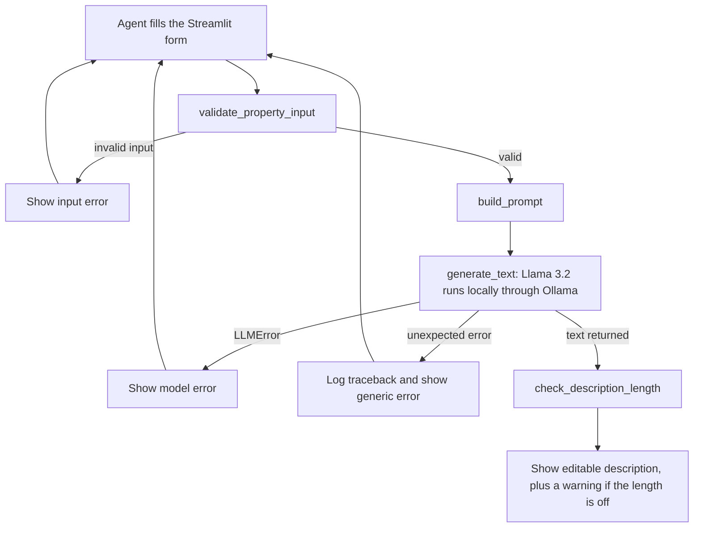

# Realistify: Real Estate Property Description Generator

Realistify turns a few property facts into a draft listing description in seconds, using an open-source model that runs entirely on your computer.

CAP 942 Capstone, AI Application Development. Author: Govind Mundada.


---

## 1. Application Overview

**Purpose.** The app takes structured property details (address, property type, bedrooms and bathrooms, square footage, lot size, year built, a list of key features, and optional free-text notes) and produces a one-paragraph draft description suitable for a listing. The text is generated by a locally running open-source language model.

**Problem it solves.** Writing a fresh description for every listing is repetitive, and descriptions written under time pressure tend to be generic or inconsistent. A tool that turns the known facts into a first draft saves time and gives every listing a consistent starting point, while leaving the final wording to the agent.

**Intended users.** Independent real estate agents, small brokerages, and property managers who write their own listings and want an editable first draft.

**Important:** the output is a *draft for the agent to review and edit*, not a finished listing. See [Limitations](#9-limitations-responsible-use-and-claims-the-app-does-not-make).

---

## 2. Features and Functionality

| Feature | What it does | How the LLM is involved |
|---|---|---|
| Property form with validation | Collects address, type (single-family, condo or townhouse), beds/baths, square footage, lot size, year built, features and optional notes; rejects bad input with a specific message (for example a non-two-letter state, a future build year, or notes over 1,000 characters) | None. It runs before the model is called, and only validated data reaches the prompt |
| Prompt construction | Turns the validated data into one prompt; leaves out empty optional fields | Controls everything the model sees |
| Description generation | Sends the prompt to a locally running model and returns the text | **The only place the LLM is used** (Llama 3.2 via Ollama) |
| Output length check | Warns the agent if the description is unusually short or long | None. It checks the model's output |
| Error handling | Separate messages for bad input, model problems (Ollama not running, model not installed, empty reply), and unexpected failures | None. It reports what went wrong around the model call |

---

## 3. Technical Workflow Diagram




The capstone's required diagram elements map to this project as follows:

| Required element | In this project |
|---|---|
| User input flow | Streamlit form, then validation |
| LLM interaction | One call to Llama 3.2 through the Ollama Python client (`generate_text`) |
| Retrieval / vector database | None. All facts come from the form, so there is nothing to retrieve |
| API / UI flow | Streamlit (`app.py`) calls `generate_description` in `main.py` |
| Output handling | Length check, then an editable text area; errors are shown by type |

---

## 4. Application Architecture

| Component | File | Responsibility |
|---|---|---|
| UI | `app.py` | Renders the form, calls the pipeline, shows results and errors. Contains no prompt text or model logic |
| Pipeline | `main.py` | `generate_description()` runs validation, then prompt building, then the model call. Also a small command-line runner |
| Validators | `generator/validators.py` | Checks every field and returns a clean dict, or raises `ValueError` with a readable message |
| Prompt builder | `generator/prompt_builder.py` | Pure function: validated data in, prompt string out. No networking |
| LLM client | `generator/llm_client.py` | The only code that talks to Ollama; turns connection and model errors into `LLMError` |
| Output checks | `generator/output_checks.py` | Length warning for the generated text |

**How data flows.** When the agent clicks *Generate description*, `app.py` collects the field values into a dictionary (splitting the features text box into a list) and calls `generate_description()` in `main.py`. That function first calls `validate_property_input()`, which returns a cleaned dictionary or raises `ValueError`. `app.py` catches it and shows an input error, and the model is never called. For valid data, `build_prompt()` fills the prompt template and leaves out any empty optional fields, and `generate_text()` sends the prompt to Ollama, which runs Llama 3.2 locally. `generate_text()` strips the reply and raises `LLMError` if the server cannot be reached, the model is not installed, or the reply is empty; `app.py` catches that and shows a model error. Any other exception is logged to the terminal and shown to the agent as a generic message. On success, `check_description_length()` may add a warning, and the text appears in an editable text area.

---

## 5. Tools, Libraries and Frameworks

| Category | Choice |
|---|---|
| LLM | Llama 3.2 (3B, `llama3.2`), open source |
| Model runner | Ollama (local, no API key, no paid service) |
| UI framework | Streamlit |
| Python libraries | `streamlit`, `ollama` (Python client) |
| Testing | `pytest` (development dependency) |
| Project / dependency management | `uv` |
| Vector database | None, and why: the app has no retrieval step |

Exact versions are in `pyproject.toml` and `uv.lock`.

**Why a local 3B model.** It keeps property details on the user's own machine, costs nothing, needs no API key, and fits comfortably in 16 GB of RAM. In the final evaluation run it averaged 5.0 seconds per description on a Windows 11 laptop with 16 GB RAM, and the first call after the model had been idle took up to about 11 seconds while Ollama loaded it.

**Data and input sources.** No external dataset is used. Inputs are entered by the user. The evaluation samples in `evaluation/samples.py` are fictional properties written for testing.

---

## 6. Setup and Running

**Requirements:** Windows, macOS or Linux; about 16 GB RAM recommended for the 3B model. Developed and tested with Python 3.14.7 on Windows 11; `uv` installs the Python version that `pyproject.toml` asks for.

1. **Install uv:** see the [uv installation guide](https://docs.astral.sh/uv/getting-started/installation/).
2. **Install Ollama** from [ollama.com](https://ollama.com) and make sure it is running.
3. **Download the model** (about 2 GB, once):
   ```bash
   ollama pull llama3.2
   ```
4. **Clone the repository and install dependencies:**
   ```bash
   git clone https://github.com/govind01-dev/Govind_Mundada_CapstoneAI.git
   cd Govind_Mundada_CapstoneAI
   uv sync
   ```
5. **Run the app:**
   ```bash
   uv run streamlit run app.py
   ```
   Then open the local URL Streamlit prints (usually `http://localhost:8501`). Stop it with `Ctrl+C`.

**Run the tests** (no Ollama needed):
```bash
uv run pytest -v
```

**Run the quality evaluation** (needs Ollama; takes a few minutes):
```bash
uv run python -m evaluation.run_samples
```
This writes a results file under `evaluation/`. Change `OUTPUT_FILE` in `evaluation/run_samples.py` first if you do not want to overwrite an existing one. Use `python -m` with the dotted module name; running the file by path fails because Python cannot find the `generator` package.

**Troubleshooting**

| Message | Cause | Fix |
|---|---|---|
| "Failed to connect to the local LLM server" | Ollama is not running | Start the Ollama app, or run `ollama serve` |
| "The model 'llama3.2' was not found" | Model not downloaded | Run `ollama pull llama3.2` |
| First generation is slow | Ollama loads the model into memory on the first call, and again after it has been idle | Wait; later calls are faster |


---

## 7. Example Inputs and Outputs

These are real outputs from the final prompt version (v3). Output varies from run to run, so a second run will not match word for word.

**Example 1: features only, no notes** (Columbus, OH)

- Single-family, 3 bedrooms, 2 full bathrooms, 1,650 sq ft above grade, 0.18-acre lot, built 1988
- Features: two-car detached garage, stainless steel appliances, central air conditioning
- Notes: none

> This 1988 single-family home in Columbus, OH, features 3 bedrooms, 2 full bathrooms, and 1650 square feet of above-grade living space. The property boasts a 0.18-acre lot and a two-car detached garage. Stainless steel appliances and central air conditioning are among its key features.

A clean result: every statement comes from the input and nothing is added.

**Example 2: sparse input** (Denver, CO)

- Condo, 1 bedroom, 1 full bathroom, 650 sq ft, 0.05-acre lot, built 2018
- Features: none. Notes: none

> This 1-bedroom, 1-bathroom condo in Denver, CO, features 650 square feet of above-grade living space. Built in 2018, the property sits on a 0.05-acre lot.

Short because little was provided, which is intended. The wording "sits on a 0.05-acre lot" is a known limitation: the form requires a lot size, and a condo does not have its own lot.

**Example 3: agent notes repeated** (Austin, TX)

- Single-family, 4 bedrooms, 2 full bathrooms, 2,100 sq ft, 0.22-acre lot, built 1995
- Features: fenced backyard, attached garage
- Notes: "Located right near top-rated schools! Quiet and extremely safe neighborhood perfect for families with kids."

> This single-family home in Austin, TX boasts 4 bedrooms, 2 full bathrooms, and 2100 square feet of living space. Built in 1995, the property features an attached garage and a fenced backyard. Situated on a 0.22-acre lot, it is located in a quiet and safe neighborhood near top-rated schools, ideal for families with children.

Everything in the last sentence came from the agent's notes, even though the prompt tells the model not to make claims about schools, safety, or who a home suits. See [Limitations](#9-limitations-responsible-use-and-claims-the-app-does-not-make).

---

## 8. Prompt Engineering and Evaluation

The prompt went through three versions, each tested on the same 6 sample properties, 2 runs each (12 runs per version). Full scoring is in [`evaluation/quality_review.md`](evaluation/quality_review.md).

| | v1 baseline | v2: omit empty fields | v3: 120-word ceiling |
|---|---|---|---|
| Runs with invented content (of 12) | 12 | 12 | **4** |
| Buyer-fit claims | 7 | 8 | **1** |
| School / safety / location claims | 3 | 6 | **2** |
| Figure errors | 1 | 0 | 2 |
| Average words | 88 | 93 | 48 |
| Average seconds per generation | 7.8 | 8.1 | 5.0 |

- **v1** told the model to write 80 to 150 words, and printed every field, including "None provided" and zeros for empty ones.
- **v2** left empty optional fields out of the prompt. That removed the "no additional features or amenities listed" sentence the model had been repeating, but invented content stayed at 12 of 12 runs. With few facts to work from, the model padded the text with marketing language.
- **v3** replaced the length target with a ceiling ("at most 120 words; if few facts are provided, write fewer sentences; do not add details to fill space"). Invented content dropped from 12 to 4 of 12 runs, invented buyer-fit and location claims dropped to zero, and generation got faster because the outputs are shorter.

**Caveats.** The scoring was done by hand against a written checklist. Any invented judgment adjective ("cozy", "spacious") counts as a fail, which is why v1 and v2 both score 12 of 12, so check 3 cannot separate them. Twelve runs per version is a small sample, and one person did the scoring, so read the numbers as evidence of a direction, not as precise rates. v3 also introduced a new error that v1 and v2 did not have (see Limitations).

---

## 9. Limitations, Responsible Use and Claims the App Does Not Make

**Known limitations** (from testing):
- A small local model can still invent details. In the final prompt version, 4 of 12 test runs contained invented wording.
- **Agent notes are repeated.** If the notes mention schools, safety or who the home suits, the model usually repeats them, even though the prompt says not to. In testing this happened in every Austin run, across all three prompt versions.
- **Unflattering notes tend to be dropped.** "Needs plumbing updates" was left out of every Portland output.
- Condo outputs can say the unit "sits on a lot", because the form requires a lot size.
- A number can be attached to the wrong thing: both v3 Portland outputs began "This 1950 single-family home", where 1950 was the square footage and the home was built in 1920.
- Vacant land is not supported: the required fields describe buildings.

**Privacy.** The model runs locally through Ollama, so property details are not sent to an external service.

**Claims this app does not make:**
- It does not guarantee the text is accurate. The agent must check every statement against the facts.
- It does not check fair-housing or advertising-law compliance. Statements about schools, safety or who a home suits can be a compliance risk, and the agent is responsible for removing them.
- It does not guarantee unique or plagiarism-free text.

---

## 10. Challenges and Lessons Learned

- **Hallucination.** The first prompt produced invented details in all 12 test runs ("cozy retreat", "shared amenities", "well-cared for"). I found this by scoring every output against its input with a written checklist, and reduced it to 4 of 12 runs by testing three prompt versions on the same samples.
- **A length target that forced padding.** The prompt asked for 80 to 150 words, but a one-bedroom condo supplies only about seven facts, so the model filled the space with invented marketing language. Replacing the target with a ceiling fixed most of it. The output length check then had to be revisited so that it would not warn on correct short descriptions.
- **Rules the model ignores.** The prompt forbids claims about schools and safety, but when the agent's own notes contained them, the model repeated them in all 6 Austin runs. An instruction in a prompt cannot reliably override facts supplied in the same prompt, so the fix has to be on the input side, not only in the wording.
- **A fix can expose the next problem.** Removing empty fields from the prompt took out one failure and revealed padding; fixing the padding introduced "This 1950 single-family home". After that I re-scored all six samples after every change, not only the one the change was aimed at.
- **Tests that passed, or failed, for the wrong reason.** A year-range test used `year=1700` instead of `year_built=1700`, so it tested nothing and failed with "DID NOT RAISE". A model-not-found test searched for the text of the fake error and not the app's own message. A check that deliberately broke each rule showed that four of the five new validation rules had no test. The habit that came out of it: break the rule on purpose and confirm the matching test goes red.
- **An option that could never work.** `land` was in the property-type list, but its required fields (bedrooms, building square footage, year built) cannot apply to vacant land, so it could never pass validation. It was found while preparing the test samples, removed from the MVP, and listed as a next step.
- **Widget defaults can bypass validation.** The "Year built" field defaulted to its minimum (1800), which is a valid year, so a blank field submitted silently. Setting the default to empty made the validator reject it. In Streamlit, `st.download_button` also cannot be used inside a form.
- **Environment and imports.** The editor pointing at the wrong Python environment, a missing `__init__.py`, pytest not finding the package (fixed with `pythonpath = ["."]`), and scripts in subfolders needing `python -m`. These cost time without producing any new code.

---

## 11. Project Structure

```
.
├── app.py                      Streamlit UI
├── main.py                     generate_description() pipeline and command-line runner
├── generator/
│   ├── validators.py           Input validation
│   ├── prompt_builder.py       Prompt construction
│   ├── llm_client.py           Ollama client and error handling
│   └── output_checks.py        Output length warning
├── tests/                      pytest tests for each component
├── evaluation/
│   ├── samples.py              The 6 test properties
│   ├── run_samples.py          Generates results for every sample
│   ├── results_*.md            Raw outputs for each prompt version
│   └── quality_review.md       Scoring and findings
├── pyproject.toml              Dependencies (managed by uv)
├── uv.lock                     Exact dependency versions
└── README.md
```


---

## 12. Next Steps

- Support vacant land with fields that depend on the property type.
- Make lot size optional for condos.
- Screen agent notes for school, safety and buyer-fit language before they reach the model.
- Flag a four-digit number in the output that falls in the year-built range but is not the year built.
- Add a tone selector and export to a text file.

---

## 13. Credits

Built with [Streamlit](https://streamlit.io), [Ollama](https://ollama.com), [uv](https://docs.astral.sh/uv/), and Meta's Llama 3.2 model. The model is distributed under Meta's Llama 3.2 Community License; read its terms before redistributing the model or building on it.

AI Disclosure Statement
I used Claude (Anthropic) and Google AI to assist with this assignment. Specifically, these tools were used for initial brainstorming, outlining ideas, and clarifying concepts. All final arguments, writing, and formatting were reviewed, edited, and approved by me.
